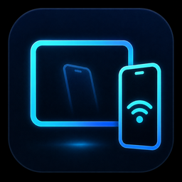

<p align="center">
  
</p>

# Mirryl

**Wireless ADB that stays connected — across reboots, sleep and network changes.**

Pair an Android phone with a Windows PC once, over Wi-Fi with a QR code or over
USB, and Mirryl keeps the `adb` connection alive by itself. Mirror the screen and
control the phone from the desktop while you are there.

**[Download for Windows](https://mirryl.com/#downloads)** — 1.0.10, ~15 MB, free
for six months per computer.

> Showcase repository: product documentation only, **no application source
> code**. See [Why no source code?](#why-no-source-code)

---

## Download

| | |
|---|---|
| Latest release | **1.0.10** (18 September 2026) |
| Platform | 64-bit Windows 10 / 11 |
| Size | ~15 MB (15,373,977 bytes) |
| Price | Free for six months per computer — no account, no license key, no card |
| Get it | **[mirryl.com](https://mirryl.com/#downloads)** |

Requirements:

- 64-bit Windows 10 or 11
- Android 11 or newer, with Developer options and Wireless debugging available
- Phone and PC on the same Wi-Fi network
- Optional: a USB cable with USB debugging, as a fallback

The license activates itself the first time the app runs. The exact terms,
including the precise number of days, are on the
[license page](https://mirryl.com/license) and in the
[legal notices](https://mirryl.com/legal).

The free Android helper app is **not published yet**, and there is no other
channel to get it. Everything above works today with the Windows app and
Android's own wireless debugging.

> **The installer is not code-signed yet.** Windows SmartScreen shows an
> "unknown publisher" warning on first run. Until that changes,
> [mirryl.com](https://mirryl.com) is the only place the app should ever be
> downloaded from. Check what you got before running it:
>
> ```
> certutil -hashfile Mirryl-Setup-1.0.10.exe SHA256
> 41588776494934AD91B6D71AF4118DFB3399C002D5DB0962265D420FBA47AE70
> ```

## What it does

- **One-time pairing, permanent connection.** Pair over Wi-Fi using a QR code
  (no cable required after setup) or USB. Mirryl reconnects on its own
  afterward — no repeated `adb pair` / `adb connect` commands.
- **Mirror it, and use it.** Video and audio stream to the desktop and your
  keyboard and mouse go back the other way, so you can type into the app you are
  debugging without picking up the phone. The streaming engine, "Mirryl
  Connect", is written for this: its own wire protocol, its own transport, its
  own video pipeline, and an on-device half that is pushed over `adb` for the
  length of a session instead of installed.
- **Device management from the desktop.** A Windows companion app lists paired
  devices, shows live connection status, and exposes controls (restart device,
  rotate mirror view, lock/unlock the phone screen, rename devices) from one
  place.
- **Survives Doze, reboots and address changes.** Measured on 7 September 2026
  against a real phone (Samsung SM-S947U1, Android 16) with the Android helper
  app installed and paired: rebooted from the desktop app, back on the wire in
  **30 s**, wireless debugging still on. Separately, the phone came back on a
  different port; the watchdog tried the stored address, failed, fell back to
  the mDNS-advertised one and reconnected in **4 s**. The reconnection logic was
  written against Android's battery-saving behavior (Doze mode), not against a
  phone with the screen on.
- **One outbound call, and it is named.** The desktop app contacts the
  activation service at `activate.mirryl.com` with a one-way hash derived from
  two of the computer's hardware identifiers, to issue and renew the free
  edition's license — at startup and roughly every six hours. The signed reply
  carries the edition, the date the machine was first registered, and the
  current version number, which is how the app knows an update exists; it is not
  a second call. No usage analytics, no crash reporter, no account. Nothing
  about the phone, the apps on it, or what is on its screen ever leaves the
  computer. Full description in the [privacy notice](https://mirryl.com/legal).
- **Diagnostics that collect nothing.** Live device state from the desktop —
  battery, storage, serial, uptime — plus a one-click repair for the firewall
  rules and the watchdog task. Mirryl deliberately does **not** capture Android
  bug reports: 1.0.1 removed that feature rather than keep pulling a device
  serial, the full installed-app list and system logs onto a support
  technician's PC. Problems go to **support@mirryl.com** instead.

## Architecture

| Layer | Technology |
|---|---|
| Desktop app | Rust + [Tauri](https://tauri.app/) (Windows) |
| Mirroring engine | Separate Rust binary, "Mirryl Connect": own wire protocol, own transport, own video pipeline |
| On-device agent | Java, embedded in the engine binary and pushed over `adb` per session with `app_process` — not an installed app |
| Android helper app | Android app in Java, free — turns wireless debugging back on after a reboot; not published yet |
| Pairing | Wi-Fi QR pairing (Android's ADB pairing protocol) and USB |

The desktop app and the mirroring engine are separate Rust binaries. The engine
drives the on-device agent over `adb` and serves an HTTP + WebSocket endpoint on
`127.0.0.1`, addressed by a per-session token. The viewer decodes H.264 with the
system WebView2/Edge `VideoDecoder` (WebCodecs) onto a canvas, not with a bundled
codec.

Nothing permanent is installed on the phone for mirroring: the agent lives for
the length of the session and the desktop kills it when the session ends. The
helper app is the one piece that stays installed, and its only job is to turn
wireless debugging back on after a reboot.

## Project status

**Released.** Mirryl 1.0.10 (18 September 2026) is public and downloadable from
[mirryl.com](https://mirryl.com/#downloads); the site has been open since
3 September 2026. The activation and licensing service is deployed, and the legal
documents (EULA, privacy policy, license) are published at
[mirryl.com/legal](https://mirryl.com/legal).

Still open, and worth saying plainly:

- **The installer is not code-signed**, so Windows SmartScreen warns on first
  run.
- **The Android helper app is not on Google Play yet**, and there is no other
  channel to get it. Nothing has been submitted. Without it you still pair and
  mirror from the desktop app using Android's own wireless debugging — you just
  re-enable it by hand on the phone after every reboot.
- Validated on real hardware, but **not yet tested** with more than three phones
  at once, with handsets from other manufacturers, or end-to-end over USB only.

## Release history

| Version | Date | Notes |
|---|---|---|
| 1.0.10 | 18 September 2026 | Fixes-only release. Mirror control no longer drops after 30 s without input (1.0.5); the update no longer fails on a file held by a running `adb`; the "Send file" picker no longer freezes the window; the watchdog re-stamps connected phones on its own; clearer notices (setup repair, matriculation limit). Android helper 1.0.10 (versionCode 18) |
| 1.0.5 | 18 September 2026 | Fixes-only release. Phone-side agent no longer outlives the engine; watchdog handles several phones by serial |
| 1.0.3 | 17 September 2026 | Fixes-only release. Engine 0.1.15: no more black mirror window — every agent failure is reported with its reason, and the encoder negotiates a size the phone accepts |
| 1.0.1 | 7 September 2026 | Fixes-only release; Android bug-report capture removed |
| 1.0.0 | 3 September 2026 | First public release |

## Why no source code?

This repository exists to document the project publicly — for a portfolio, for
prior-art/timestamp purposes, and so people can see what Mirryl does without
needing a build of it. The source is developed in a private repository. The
compiled application is distributed from
[mirryl.com](https://mirryl.com/#downloads), free for six months per computer.

## Ownership

Mirryl is an independent product, designed, developed, and owned by **Johan
Socarras**. All rights reserved. Third-party components used inside the compiled
application are documented and attributed in the application's own "Third-party
licenses" screen, per each component's license terms.

## License

All rights reserved. This repository contains no source code and grants no
license to reuse its content — see [LICENSE](LICENSE). GitHub labels it "Other"
because the terms are custom rather than a standard open-source license.

## Contact

- Bug reports and support: **support@mirryl.com** — tell me what you did, what
  you expected, and what happened instead.
- Legal and privacy: **legal@mirryl.com**
- Product site: [mirryl.com](https://mirryl.com)
