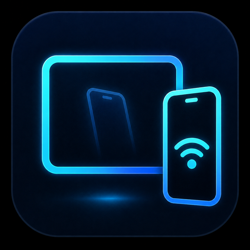
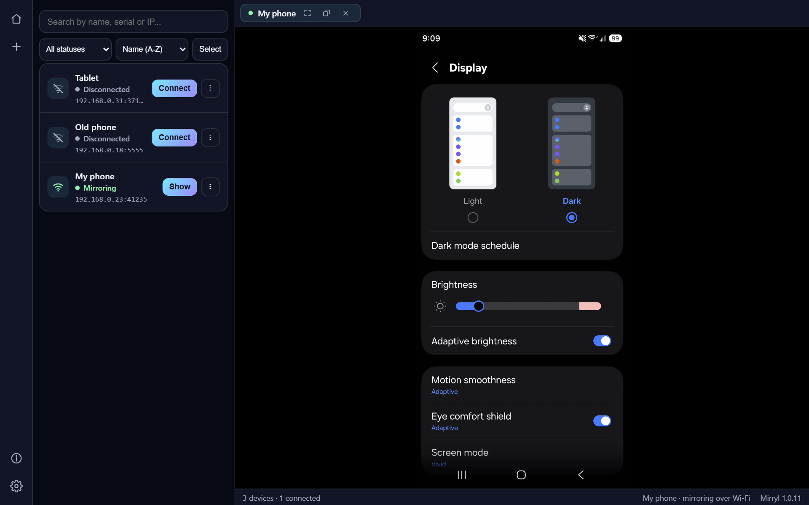
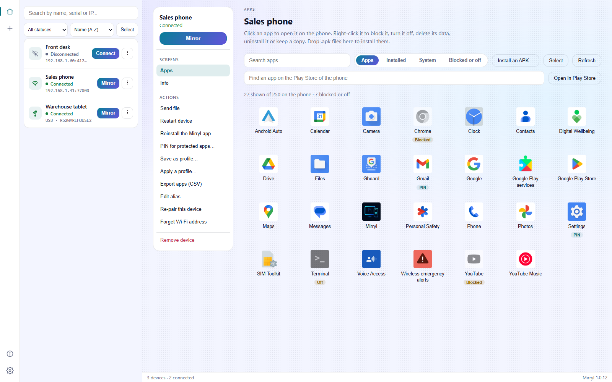

<p align="center">
  
</p>

<h1 align="center">Mirryl</h1>

<p align="center">
  Mirror and control your Android phone from your PC, over USB or Wi-Fi.<br>
  For Windows and Linux, built with Rust and Tauri.
</p>

<p align="center">
  <a href="https://github.com/johan-socarras/Mirryl/actions/workflows/ci.yml"></a>
  <a href="https://github.com/johan-socarras/Mirryl/releases/latest"></a>
  <a href="LICENSE"></a>
  
</p>



<p align="center"><sub>The phone names and addresses in the picture are examples.</sub></p>

Mirryl shows your phone's screen on your PC, plays its sound, and lets you use
it with the mouse and keyboard. Each phone opens in a tab of the Mirryl
window, and any tab can become a window of its own. Pairing is wireless (QR
code or six-digit code), and USB works too. From the PC you can also manage
the apps of each phone: open, install, block, protect with a PIN, uninstall,
and do the same on several phones at once.

Mirryl is free. It has no account, no activation and no telemetry: it does
not connect to the internet.

## Install

Windows 10 or 11 (64-bit), in PowerShell:

```powershell
irm https://raw.githubusercontent.com/johan-socarras/Mirryl/main/install.ps1 | iex
```

Linux (Debian, Ubuntu and their derivatives, x86-64), in a terminal:

```bash
curl -fsSL https://raw.githubusercontent.com/johan-socarras/Mirryl/main/install.sh | bash
```

Both download the package of the
[latest release](https://github.com/johan-socarras/Mirryl/releases/latest),
check it against the SHA-256 that GitHub publishes for it, and install it.
Running them again updates Mirryl. Read the scripts first if you like:
[`install.ps1`](install.ps1), [`install.sh`](install.sh). To install by hand,
see [Install from the release](#install-from-the-release).

Then open Mirryl and follow the setup: it pairs the phone and offers to
install the companion app on it.

## Features

- **Wireless pairing** with Android's own Wireless debugging: scan a QR code
  or type a six-digit code. USB works too.
- **Tabs**: the phones on the left, one tab per open mirror. A tab can be
  moved to its own window and back without dropping the connection.
- **The phone on your screen**: video and audio, mouse and keyboard, and
  Android's Back, Home and Recents. **Fill** (Ctrl+F) crops the picture to
  use the whole tab, for landscape video.
- **Clipboard both ways**, and **Send file** to the phone's Download folder.
- **The companion app comes with Mirryl**: during setup, Mirryl installs it
  on the phone with one button.
- **Auto-reconnect** (Windows): the companion app keeps Wireless debugging
  on, and a background task on the PC reconnects known phones after a reboot
  or a Wi-Fi drop.
- **Several phones** at once.
- **Apps screen** for each phone: every app with its icon, a search box and
  filters. Click an app to open it on the phone; right-click it to block or
  unblock it, turn it off, delete its data, uninstall it or save a copy of
  its APK. Drop `.apk` files on the screen to install them, or open an app's
  page in the phone's Play Store.
- **PIN for chosen apps**: a protected app asks for a PIN before it opens on
  the phone (Settings, for example). The phone keeps only a hash of the PIN,
  and the PC can change or remove it if it is forgotten.
- **Profiles and bulk actions**: select apps or phones and act on all of them;
  save a phone's blocked and PIN-protected apps as a **profile** and apply it
  to other phones; install the same APK on several; export their app lists
  to a CSV file.
- **User guide**: a PDF, opened from About, that explains every screen and
  button.



<p align="center"><sub>The phones in the picture are examples.</sub></p>

Some of this is Windows only: the background task that reconnects phones
after a reboot also turns the PIN protection back on if it was switched off
on the phone. Linux has no background task.

## Requirements

- **Windows** 10 or 11 (64-bit), or **Linux** on x86-64 with `.deb` packages
  (Debian, Ubuntu and their derivatives). The Linux version is tested on
  Ubuntu 26.04.
- An Android phone with Android 11 or newer and Developer options enabled.
- The PC and the phone on the same network for Wi-Fi use.

## Install from the release

Both packages are in the
[latest release](https://github.com/johan-socarras/Mirryl/releases/latest).

### Windows

Download `Mirryl_<version>_x64-setup.exe` and run it. It installs for the
current user and does not need administrator rights; Windows asks once for
permission to add the firewall rules and the reconnect task.

The installer is not code-signed, so Windows SmartScreen will warn
("Windows protected your PC"): choose **More info → Run anyway**.

### Linux

Download `Mirryl_<version>_amd64.deb` and install it with apt, which also
brings in what it needs (adb, zenity, GStreamer and WebKitGTK):

```bash
sudo apt install ./Mirryl_<version>_amd64.deb
```

Linux has no background reconnect task: connect a phone from the device
list when you open Mirryl.

## How it works

Mirryl has three parts:

| Part | What it is |
|---|---|
| `app/` | The PC app (Rust + [Tauri](https://tauri.app)): device list, tabs, pairing, setup and settings; on Windows also the background reconnect task (`watcher.ps1`). |
| `engine/` | **Mirryl Connect**, the mirroring engine (Rust): a small Java agent it starts on the phone captures the screen and audio and injects input; on the PC the picture is shown by WebView2 on Windows and WebKitGTK on Linux. |
| `android/` | The companion phone app (Java, no Gradle): keeps Wireless debugging enabled so the PC can reconnect. |

Everything talks over [adb](https://developer.android.com/tools/adb): the
Windows installer ships it, and on Linux it is the system's package. Nothing
leaves your PC and your local network. The engine is an independent
implementation; see
[`engine/docs/INDEPENDENT_IMPLEMENTATION.md`](engine/docs/INDEPENDENT_IMPLEMENTATION.md).

## Building from source

See [`docs/BUILD.md`](docs/BUILD.md).

## Privacy

Mirryl collects nothing and sends nothing anywhere. What it keeps on your PC
and on your phone is described in
[`PRIVACY.txt`](app/src-tauri/PRIVACY.txt) (Windows) and
[`PRIVACY-linux.txt`](app/src-tauri/PRIVACY-linux.txt) (Linux).

## License

Mirryl is **source-available** under the
[PolyForm Shield License 1.0.0](LICENSE): you may use it for any purpose,
change it and share it, but not to offer a product that competes with Mirryl.
It is not an OSI open-source license.

Third-party components keep their own licenses; see
[`THIRD_PARTY_LICENSES.txt`](app/src-tauri/THIRD_PARTY_LICENSES.txt) (Windows)
and [`THIRD_PARTY_LICENSES-linux.txt`](app/src-tauri/THIRD_PARTY_LICENSES-linux.txt)
(Linux).

Mirryl is made by one person and comes with no promise of support or
updates. Bug reports and questions are welcome as
[issues](https://github.com/johan-socarras/Mirryl/issues).
